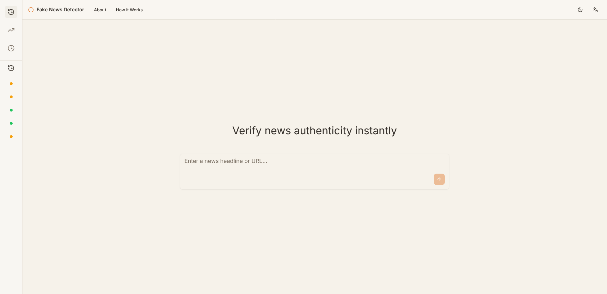
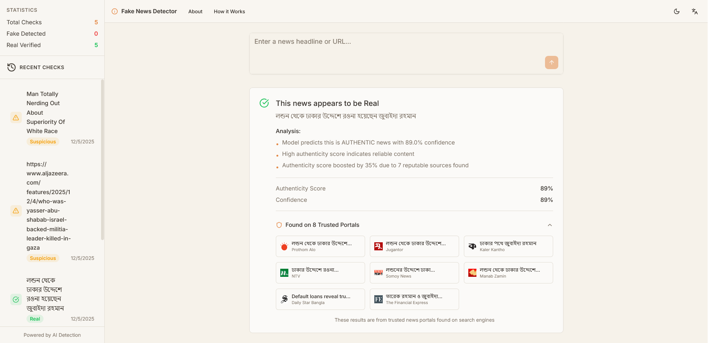

# Fake News Detector

A web-based **Fake News Detection system** that verifies news headlines and article content using machine learning models, exposed through a Flask REST API and consumed by a modern React frontend.

The project is designed as a **full-stack application** where users can submit either a **news headline or a news article URL** and receive predictions about whether the content is likely to be fake or credible. It supports **English and Bangla** datasets and demonstrates an end-to-end ML-backed web workflow, from web content extraction and preprocessing to model inference and frontend visualization.

## Project Overview

The Fake News Detector aims to address the growing spread of misinformation by providing an automated, lightweight verification tool for online news. The system separates concerns cleanly:

- A **frontend** built with Vite and React for fast development and responsive UI
- A **backend API** built with Flask that handles scraping, preprocessing, and inference
- **Machine learning models** trained offline using labeled datasets and loaded at runtime for prediction

The application focuses primarily on **headline-level and extracted article text analysis**, making it suitable for quick credibility checks of online news links.

## Screenshots

Below are screenshots of the application interface and verification results:



_Landing page showing the input form._



_Verification results card and recent enquiries history._

## Key Features

- Fake news classification from headlines or news URLs
- Automated article content extraction using BeautifulSoup
- RESTful API for detection and credibility checking
- Support for multiple languages (English and Bangla datasets)
- Decoupled frontend and backend architecture
- Reproducible development environment using `pnpm` and Python virtual environments

## System Architecture (High-Level)

1. **User Interface (React + Vite)**  
   Users submit a news headline or a news article URL through the web UI.

2. **Backend API (Flask)**  
   The frontend sends requests to Flask endpoints exposed under `/api`.

3. **Content Extraction Layer**  
   If a URL is provided, the backend fetches the web page and extracts relevant textual content using **BeautifulSoup**.

4. **ML Inference Layer**  
   Pre-trained models and vectorizers are loaded by the backend service and used to generate predictions.

5. **Response Handling**  
   The backend returns prediction results to the frontend in JSON format.

## Web Content Extraction (BeautifulSoup)

The backend uses **BeautifulSoup** to extract meaningful text from news article URLs:

- Sends an HTTP request to the provided news URL
- Parses the HTML response using BeautifulSoup
- Removes non-content elements such as scripts, styles, navigation bars, and ads
- Extracts headline text and main article body (e.g., `<h1>`, `<p>` tags)
- Normalizes and concatenates the extracted text
- Passes cleaned text to the machine learning pipeline for inference

This allows users to verify news articles directly from URLs without manually copying headlines or content.

## Tech Stack

### Frontend

- Vite
- React
- pnpm (package management)

### Backend

- Python 3
- Flask
- BeautifulSoup (HTML parsing and content extraction)
- Requests (HTTP fetching)

### Machine Learning

- Jupyter Notebooks (for experimentation and training)
- CSV-based datasets for English and Bangla

## Supported API Endpoints

| Method | Endpoint                 | Description                                                     |
| ------ | ------------------------ | --------------------------------------------------------------- |
| POST   | `/api/detector`          | Detects whether a headline or extracted article is fake or real |
| POST   | `/api/credibility-check` | Returns a credibility assessment                                |

## Models & Datasets

- **Notebooks**

  - `model/Detector.ipynb`
  - `model/Detector (2).ipynb`

- **Datasets**
  - `model/dataset/en.csv`
  - `model/dataset/bn.csv`

## Setup & Running the Project

### Frontend

```bash
cd client
pnpm install
pnpm run dev
```

### Backend

```bash
cd server
python3 -m venv venv
source venv/bin/activate
pip install -r requirements.txt
python run.py
```

The frontend expects the backend to be available at:

```
http://localhost:5000/api
```

## Intended Use

- Academic coursework and demonstrations
- Learning full-stack ML application design
- Practicing web scraping with BeautifulSoup
